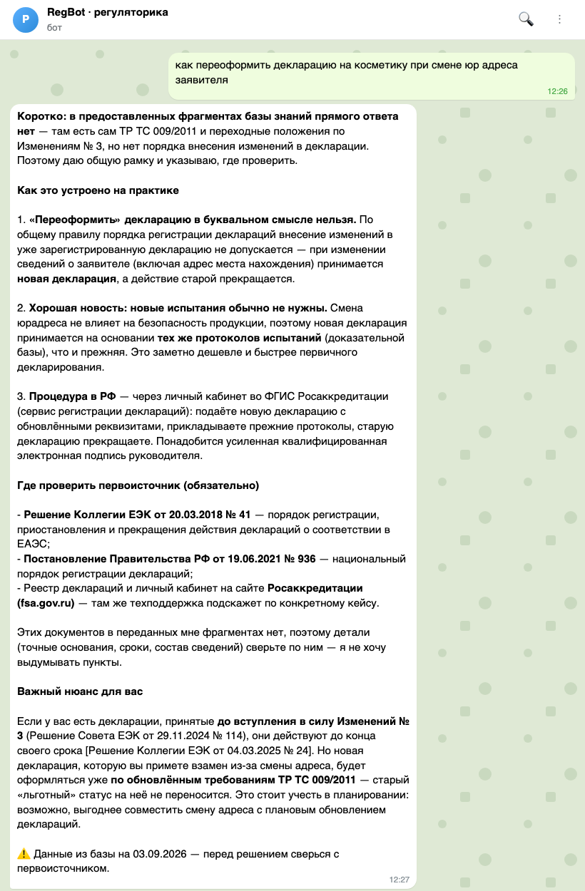

# РегБот: Telegram-ассистент по регуляторике медизделий и косметики

> RAG-бот для продуктолога без единой pip-зависимости: корпус нормативных актов (ЕАЭС, РФ, таможня), полнотекстовый поиск SQLite FTS5, LLM через подписку ChatGPT (Codex CLI) без API-ключей, живые проверки реестров Росздравнадзора и Росаккредитации и еженедельный дайджест изменений. Всё на одном Mac mini под launchd.
>
> *Regulatory assistant bot (medical devices, cosmetics, customs/import from China) for a product manager: Python stdlib + SQLite FTS5 RAG with citations, registry checks, weekly digest. No pip deps, no API keys.*

Сделан для производителя пластырей и патчей, работает с сентября 2026. Корпус включён в репозиторий: 40+ нормативных актов в текстовом виде с манифестами (номер, дата, редакция, источник).



## Что умеет

- **Вопрос текстом** → ответ по базе знаний с цитатами и ссылками на первоисточник, кнопки 👍/👎 для обратной связи. Темы: регистрация медизделий (РУ, классы риска, ПП 1684, правила ЕАЭС), косметика (ТР ТС 009/2011, декларации, СГР), таможня и ввоз из Китая (ТН ВЭД, НДС, «Честный знак»), формулировки для карточек и упаковки.
- `/ru <название | номер РУ | производитель>` — реестр медизделий Росздравнадзора: кэш на 24 часа или прямая ссылка на первоисточник.
- `/decl <номер | ИНН | продукция>` — реестр деклараций Росаккредитации.
- **Еженедельный дайджест** (понедельник 08:30): RSS Альта-Софт и Росздравнадзора → LLM отбирает важное для нашей продукции → рассылка пользователям.
- Доступ по белому списку: новый человек пишет `/start`, админу приходит заявка; `/adduser`, `/users`, `/stats`.
- Каждый ответ помечен: «данные из базы на дату сборки, перед решением сверься с первоисточником».

## Как устроено

```
app/bot.py         long polling Bot API, команды, доступ, кнопки фидбека
app/tg.py          минимальный клиент Telegram Bot API на urllib
app/search.py      RAG: LLM формулирует поисковые запросы → FTS5 → LLM отвечает с цитатами
app/llm.py         роутер движков (Codex CLI по подписке), остывание при лимитах, состояние в data/
app/registries.py  Росздравнадзор и Росаккредитация: кэш 24 ч или ссылка
app/monitor.py     дайджест: RSS → отбор LLM → рассылка
app/ingest.py      corpus/ → SQLite (чанки, FTS5 unicode61)
app/db.py          схема: documents, chunks (FTS5), users, dialogs, feedback, cache
corpus/raw/        med/ cosmetics/ customs/ — тексты НПА + _manifest*.json
corpus/reviews/    три обзорных отчёта по темам (стартовая точка для корпуса)
launchd/           плисты бота и дайджеста
```

Поиск двухступенчатый: LLM превращает вопрос продуктолога в 2–4 формальных запроса («класс риска 2а правила регистрации ЕАЭС»), FTS5 отдаёт фрагменты, LLM собирает ответ только из них и обязан ставить ссылки. Даты и ставки берутся из фрагментов, не «из головы».

## Запуск

```bash
git clone https://github.com/Vladislav352/regbot && cd regbot
cp data/config.json.example data/config.json && chmod 600 data/config.json   # token, admin_ids
python3 -m app.ingest            # собрать базу из corpus/ (~1 мин)
python3 -m app.bot               # ручной запуск; Ctrl+C
```

Автозапуск на macOS: `launchd/*.plist` (поправить пути). Обновление корпуса: положить `.txt` в `corpus/raw/<тема>/`, дописать манифест, `python3 -m app.ingest`. Волатильные темы (ставки, перечни, сроки маркировки) стоит освежать раз в квартал.

Требования: Python 3.11+ (sqlite3 с FTS5), установленный Codex CLI с активной подпиской ChatGPT (или замените движок в `app/llm.py` на любой API).

## Что было сложного

- **Без API-ключей.** Заказчик не хотел заводить платные ключи. Решение: `codex exec` через подписку ChatGPT как LLM-движок, с остыванием при лимитах и честным сообщением пользователю, если движок исчерпан.
- **Галлюцинации по датам и ставкам.** Промпт запрещает отвечать вне фрагментов, ответ всегда с источником, плюс предупреждение о дате сборки базы.
- **Реестры без официального API.** Проверки реестров сначала делались LLM-агентом, это было дорого и ненадёжно; заменено на кэш и прямые ссылки для ручной проверки.

## Автор

Владислав Арсентьев, AI-интегратор. Собрано с Claude Code.
